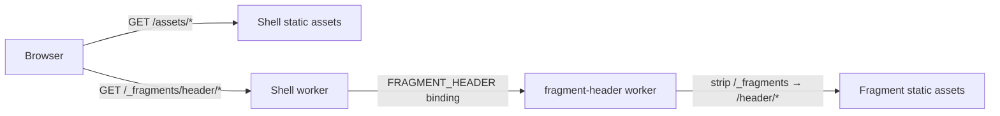

# Build & Assets

Sources: `framework/src/vite/fragment.ts`, `framework/src/collect-assets.ts`, `framework/src/fragment-protocol.ts`

Shell assets and fragment assets are handled separately:

- **Shell** (Vue runtime, shell JS/CSS): each app collects its own files into `packages/apps/<app>/dist/static/assets/`, served by that app's `ASSETS` binding.
- **Fragments**: each fragment ships its own client assets and serves them itself under `/_fragments/<id>/*`. A fragment deploy never needs a shell deploy. See [Fragment-Owned Assets](../thinking/project-fragment-owned-assets.md).

## Build Order

1. `pnpm -r run build` builds every package.
2. Fragments run `vite build --mode client && vite build`. The client build runs first, because the server build inlines the client manifest.
3. Apps run `vite build && vite build --mode client`.
4. `collectAssets()` runs during `framework-cli preview` and `framework-cli deploy`, for **apps only**.

## Fragment Build

### Client (`--mode client`)

- `base` = `FRAGMENT_ASSET_BASE` env var, defaulting to `/_fragments`.
- Files are written under `dist/client/<id>/` (entry, chunks, CSS), so the URL is `<base>/<id>/<file>`.
- `vue` is external and resolved through the shell's import map.
- Extra files:
  - `_headers`: `Cache-Control: public, max-age=31536000, immutable`
  - `.assetsignore`: keeps `.vite/manifest.json` private

### Server

The `virtual:fragment-build-info` module reads `dist/client/.vite/manifest.json` and inlines:

```json
{
  "version": "header@232e6536",
  "vue": "3.5.31",
  "assets": {
    "js": "/_fragments/header/fragment-header.CZPg0p9a.js",
    "css": ["/_fragments/header/fragment-header.D6XthhtI.css"]
  }
}
```

- `version` = fragment ID + a hash of the client manifest. It's content-based, so the same code gives the same version.
- `vue` = the Vue version the fragment compiled against.
- A custom `src/entry-server.ts` can `import buildInfo from 'virtual:fragment-build-info'`.

## Serving



- Shell: `/_fragments/<id>/*` is forwarded to the `FRAGMENT_<ID>` binding, and an unknown ID returns 404.
- Fragment: `assets.run_worker_first: true`, so the Worker serves `/_fragments/*` from `env.ASSETS` and renders everything else.
- Production with a CDN: build with `FRAGMENT_ASSET_BASE=https://static.<domain>` and upload `dist/client/<id>/` to that origin. Not implemented yet.

## `collectAssets()` (shell only, per app)

For each app:
1. Clean `<app>/dist/static`.
2. Read `<app>/dist/client/.vite/manifest.json`, record logical → hashed names, and copy the files to `<app>/dist/static/assets/`.
3. Detect `vue.[hash].js`, which is emitted as a raw asset and isn't in the Vite manifest.
4. Write `<app>/dist/static/assets/manifest.json` and `<app>/dist/static/_headers`.

Each app's `wrangler.jsonc` has `assets.directory: "dist/static"`. Apps must not share a static folder: every shell build produces the logical names `shell.js` and `shell.css`. A shared manifest let the last app overwrite the others, so back-office was running front-office's client bundle.

```json
{
  "shell.js": "shell.CetAH-Kc.js",
  "shell.css": "shell.D_Ll61a1.css",
  "vue.js": "vue.01104521.js"
}
```

The shell lazy-loads this manifest once per isolate from its `ASSETS` binding, and `buildShellTags()` resolves the logical names.

## Local Preview

- `framework-cli preview` runs every Worker in one `wrangler dev` process. Static assets for secondary Workers need wrangler ≥ 4.165, because older versions return 500.
- It clears `packages/apps/<app>/.wrangler/state/v3/cache` on start. Otherwise, cached pages and fragments from a previous build would reference assets that no longer exist.
